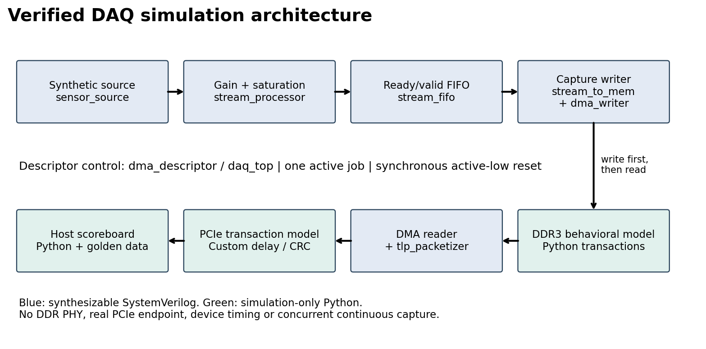
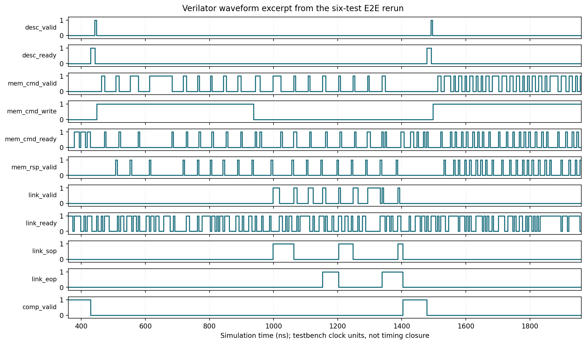

# FPGA High-Speed DAQ — RTL simulation portfolio

**SystemVerilog · cocotb · Verilator · Python · Yosys**

A single-clock acquisition pipeline with ready/valid buffering, saturating gain, ring-buffer DMA and packetized host readback. **63 tests pass; 33 end-to-end scenarios match independent expected records.** DDR3 is a **behavioral model**; PCIe is a **custom transaction-level model**, not a hardware endpoint.





The waveform comes from an executed regression. [Full VCD](evidence/core/daq_top.vcd.gz) · [Trace provenance](portfolio/assets/evidence.json)

| Verified result | Evidence |
|---|---|
| **63/63 PASS**, zero failures/skips | 39 pytest + 24 cocotb; [actual clean-checkout log](evidence/core/verify.log) |
| **33/33 MATCH** | 15 baseline + 18 extended scenarios **within** those tests; [results](evidence/core/verification.json) |
| Independent checks detect six injected defects | [Mutation results and coverage limits](docs/VERIFICATION_REVIEW.md) |
| Generic synthesis: 1,447 flip-flops, no latches/loops | [Yosys evidence](evidence/core/synthesis/); 42-cell topological path, **not device timing closure** |

### Debugging findings

- **4 KiB crossing:** a packet starting at `0x1ff8` crossed a page. Bound payload length by page remainder; [original failing assertion](evidence/debug/boundary-before-fix.xml) retained.
- **Address boundary:** fixed rejection of the final legal 8-byte record at `2^64−8` by validating the last addressed byte.
- **Delayed delivery:** retained host tag ownership until data consumption, even after RTL completion.
- **False-success runner:** reject failed/stale/empty/skipped JUnit; a real failing fixture verifies the gate. [Review](docs/VERIFICATION_REVIEW.md)

### Reproduce

Requires Docker, Make and Python 3. Run from the repository root:

```sh
make tools
make verify                 # lint, 63 tests / 33 scenarios, generic synthesis
make timing                 # structural checks; no device delays or slack
```

Recorded versions: Verilator 5.040, cocotb 2.0.0, pytest 8.4.2, Yosys 0.33. [Commands, versions and clean-checkout scope](docs/REPRODUCING.md) · [Simulation benchmark](portfolio/assets/benchmarks.png)

### Explore the engineering

[Architecture and RTL modules](docs/architecture.md) · [Verification review](docs/VERIFICATION_REVIEW.md) · [Portfolio summary](portfolio/README.md) · [Resume bullets](docs/RESUME_BULLETS.md) · [Release summary](release/RELEASE_SUMMARY.md)

One descriptor is active at a time; capture finishes before readback. The source honors backpressure. No physical ADC, DDR PHY, real PCIe TLP/LCRC, FPGA implementation, device STA or measured throughput is claimed. [Interface contracts](docs/interface_contracts.md) · [Synthesis scope](synthesis/README.md)

### Separate PCB Rev 0.3.1 design study

The [Pi 5 FFC-to-M.2 carrier](hardware/reference_pcie_adapter/README.md) is **not the FPGA DAQ board**. Native CAD checks pass; engineering acceptance remains **FAIL**:

| Requirement | Retained result |
|---|---|
| Voltage: 3.135–3.465 V | 3.130447–3.487610 V; margins **−4.553 / −22.610 mV** |
| Thermal screen: ≤125 °C | **6/24 FAIL**; fine-grid worst **160.303 °C**, margin **−35.303 °C** |
| Differential impedance: 81–99 Ω | Broad high corner **106.126 Ω**, margin **−7.126 Ω** |

These are modeled rejection indicators, not measurements or qualified operating conditions. [All cases and root causes](hardware/reference_pcie_adapter/INDEPENDENT_REVIEW.md) · [Pass/fail matrix](docs/REQUIREMENTS_MATRIX.md). No fabrication, purchases or physical validation. Published **as a simulation portfolio with a separate design study**. Local verification evidence is retained; live CI status is available in [GitHub Actions](https://github.com/searchyourmind/fpga-highspeed-daq/actions).
