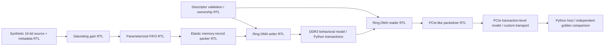

# Architecture

All RTL is in one synchronous clock domain. A descriptor owns a bounded region of the modeled memory until the writer has acknowledged all records and the reader has sent all records into the packetized link. The ring index wraps; a second descriptor waits until completion is acknowledged. The baseline deliberately uses store-and-forward and one outstanding memory command. Therefore it is easy to audit ordering, but does not represent a peak-throughput memory subsystem.

Default physical storage represented by the model: 4096 bytes. Default descriptor ring: 32 records (256 bytes). FIFO: 8 records. Each 64-bit record contains one 16-bit sample, 32-bit per-descriptor sequence, a frame marker and a 15-bit frame ID. FIFO data width includes sidebands; it does not imply a 64-bit ADC.

Saturating gain uses one elastic pipeline register. The packer adds one register. Under no stalls the processing and packer each accept one record/cycle, but DMA waits for each memory response and serializes writing then reading. Actual integrated throughput is measured from simulation cycles and includes descriptor/completion overhead.

## Implemented versus environment
- Synthesizable: every file in `rtl/`, including source, processor, FIFO, address/descriptor logic and packet framing.
- Behavioral environment: `sim/ddr_behavioral`, `sim/pcie_transaction`, `sim/host_model`.
- Golden oracle: `tb/reference_model.py`, computes expected records directly from the mathematical input specification. It does not read DUT memory.
- Independent hardware references: `hardware/power_tree` and `hardware/reference_pcie_adapter`. Neither is a board for this RTL design.

## Real DDR versus this abstraction
Real DDR3 involves bank/row/column commands, activate/precharge policies, burst transfer electrical timing, periodic refresh, DQS sampling and PHY initialization/calibration. Here the address is a linear byte address; bursts are atomic ordered model operations; periodic request stalls stand in for unavailable service. No row hits, JEDEC tRCD/tRP/tRAS, DQS or training is modeled. The RTL issues single-record memory transactions; burst behavior is exercised at the Python model API, not claimed as a burst-optimized RTL DMA.

## Real PCIe versus this abstraction
A real root complex enumerates endpoints and configures BARs; transaction-layer packets traverse data-link flow control/replay and a physical SerDes link. This project emits a custom memory-write envelope with address, payload length, tag, SOP/EOP and a model CRC. It does not emit PCIe headers or implement a root complex, BARs, enumeration, credit accounting, read completions, LTSSM, coding, equalization or a physical lane.

## RTL source map

| Modules | Responsibility |
|---|---|
| `sensor_source.sv`, `stream_processor.sv` | Synthetic samples, frame metadata, saturating gain |
| `stream_fifo.sv`, `streaming_top.sv` | Ready/valid buffering and streaming integration |
| `dma_descriptor.sv`, `stream_to_mem.sv`, `dma_writer.sv` | Descriptor validation, record packing and bounded ring writes |
| `dma_reader.sv`, `tlp_packetizer.sv`, `daq_top.sv` | Readback, page-bounded custom packet payloads and completion |
| `counter.sv` | Preserved, separately tested starter module |

All modules are under `rtl/`. Reset is active-low **synchronous**; handshakes transfer on rising edges. Stalled payload remains stable.
