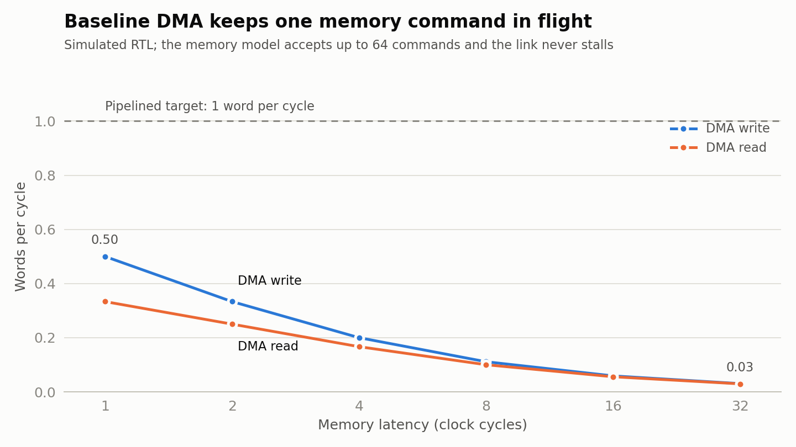

# ECP5 board build: baseline

The DAQ core placed and routed for a real FPGA: a **Lattice LFE5U-25F-6BG381C**, the chip on the 25F version of the [ULX3S](https://github.com/emard/ulx3s) board, with the open-source Yosys → nextpnr → Trellis flow. These numbers are the **baseline** to compare later optimizations against. The bitstream has not been loaded onto a board.

## Results

| | Result | Evidence |
|---|---|---|
| **Fmax** (5 placement seeds) | **55.7 / 57.3 / 58.0 MHz** min / median / max | [ecp5-summary.json](../evidence/fpga-baseline/ecp5-summary.json) |
| Board clock (25 MHz) | Met on every seed, ≥ 2.2× margin | same |
| Logic | 2,017 LUT4 + 379 carry cells; 3,017 / 24,288 logic cells after packing (12%) | same |
| Registers | 1,315 / 24,288 (5%) | same |
| Block RAM | 2 / 56 DP16KD (the 4 KiB on-chip memory) | same |
| Multipliers | 2 / 28 MULT18X18D | same |
| Bitstream | 154 KB, packed by `ecppack` | `results/fpga/fpga_top.bit` after `make fpga` |

nextpnr is given a 100 MHz target so it works as hard as it can and reports the real maximum; that is why its log says "FAIL at 100 MHz". The requirement is the board's 25 MHz oscillator.

### Critical path: two multipliers in one clock cycle

[critical-path.txt](../evidence/fpga-baseline/critical-path.txt) (median seed): 17.4 ns = 10.3 ns logic + 7.2 ns routing.

```
sensor_source.seq register
  → MULT18X18D   seq × 73            (rtl/sensor_source.sv, m_data)
  → carry chain  + 19
  → MULT18X18D   sample × gain       (rtl/stream_processor.sv, product)
  → saturation LUTs
  → stream_processor.m_data register
```

`sensor_source` drives `m_data` combinationally from `seq`, and `stream_processor` multiplies it in the same cycle. Registering the source output, or splitting the gain multiply over two stages, removes one multiplier from this path; that is the first timing optimization to try.

### Resources by module

Cells each module synthesizes to on its own (`synth_ecp5 -noflatten`). Optimization across module boundaries in the real, flattened build brings the total from 2,845 down to 2,017 LUT4.

| Module | LUT4 | FF | Carry | Other |
|---|---:|---:|---:|---|
| `tlp_packetizer` | 630 | 289 | 97 | |
| `dma_descriptor` | 286 | 151 | 86 | |
| `dma_reader` | 278 | 133 | 31 | |
| `sensor_source` | 268 | 113 | 64 | 1 multiplier |
| `dma_writer` | 212 | 68 | 31 | |
| `stream_processor` | 85 | 65 | 0 | 1 multiplier |
| `daq_top` | 82 | 31 | 0 | |
| `stream_to_mem` | 67 | 65 | 0 | |
| `stream_fifo` | 37 | 13 | 0 | 16 LUT-RAM |
| `streaming_top` | 8 | 8 | 0 | |
| **DAQ core** | **1,953** | **936** | | |
| `fpga_top` (board glue) | 607 | 328 | 30 | |
| `uart_rx` | 144 | 40 | 8 | |
| `uart_tx` | 116 | 29 | 8 | |
| `bram_memory` | 25 | 2 | 31 | 2 block RAMs |
| **Board wrapper** | **892** | **399** | | |

`tlp_packetizer` is the largest block because it carries 64-bit host addresses through registers and adders.

## DMA throughput baseline (simulation)



`make throughput` runs a 32-word job through `daq_top` at six memory latencies. The memory model accepts up to 64 commands and never refreshes, and the link never stalls, so the RTL is the only limit. [dma-throughput.json](../evidence/fpga-baseline/dma-throughput.json)

| Memory latency (cycles) | 1 | 2 | 4 | 8 | 16 | 32 |
|---|---:|---:|---:|---:|---:|---:|
| Write, cycles per word | 2 | 3 | 5 | 9 | 17 | 33 |
| Read, cycles per word | 3 | 4 | 6 | 10 | 18 | 34 |
| Commands in flight | 1 | 1 | 1 | 1 | 1 | 1 |

`dma_writer` and `dma_reader` wait for each response before issuing the next command, so a word costs latency + 1 cycles to write and latency + 2 to read. At a DDR-like 32-cycle latency the DMA moves 0.03 words per cycle. Allowing several outstanding commands, and bursts, is the second optimization.

## Board top

[`fpga_top`](rtl/fpga_top.sv) wraps `daq_top` for the ULX3S:

- **`bram_memory`** replaces external DDR with 4 KiB of block RAM (1-cycle response).
- **Descriptors arrive over the FTDI UART** (115200 baud, 8N1). If the descriptor fields were constants, synthesis would delete the validation and address logic and the numbers above would be too optimistic.
- **Every link beat and completion goes back over the UART**, with a checksum over each beat's address, tag, length and flags so the host can verify the fields it does not receive directly. The UART is slower than the core, so `link_ready` also exercises backpressure.
- Power-on reset; the FIRE1 button resets. LEDs show jobs completed, an error flag, `link_valid` and busy.

Protocol (multi-byte fields little-endian):

| Direction | Bytes |
|---|---|
| PC → FPGA | `0x5A`, id[16], start[16], length[16], base[32], host[64], owner[8], frame_len[16], gain[8] |
| FPGA → PC, per beat | `0xD0` \| {last, eop, sop}, data[64] |
| FPGA → PC, per completion | `0xC0`, id[16], status[8], beats[16], checksum[32] |

`checksum`: for each beat, rotate left by 1, then add `data[31:0] ^ data[63:32] ^ addr[31:0] ^ addr[63:32] ^ {tag, length} ^ {last, eop, sop}` (mod 2³²). An earlier XOR version missed a dropped upper address half when an all-ones value cancelled over an even beat count; addition does not cancel.

Pins come from the official ULX3S constraint file ([ulx3s.lpf](ulx3s.lpf)).

### Verification

- [`tb/test_fpga_top.py`](../tb/test_fpga_top.py) drives only the board's pins, as the PC would: ring wrap, a 4 KiB page crossing, the last 56 bytes of the 64-bit address space, saturation, an invalid descriptor, garbage before the sync byte, and the reset button pressed mid-job. Records are checked against the independent `tb/reference_model.py`; packet flags and checksums are checked against a separate Python packetizer model.
- [`tools/fpga_mutations.py`](../tools/fpga_mutations.py) injects six bugs into isolated copies (dropped address halves, swapped tag/length, swapped sop/eop, wrong BRAM word, reversed UART bit order). All six fail the test. [board-mutations.json](../evidence/fpga-baseline/board-mutations.json)
- All new modules pass the repository's `verilator --lint-only --Wall` check.

## Reproduce

```sh
make fpga-tools     # Docker image: Yosys 0.33, nextpnr-ecp5 0.6, Trellis 1.4 (Ubuntu 24.04 packages)
make fpga           # synthesis, place and route with seeds 1-5, bitstream → results/fpga/
make fpga-test      # board top in Verilator through its UART pins
make throughput     # DMA words per cycle against memory latency, and the chart
make fpga-mutations # six injected board-top bugs, each must fail fpga-test
```

Test results for these suites go to `results/board/`, apart from the 63 production cases in `results/*.xml`.

Vivado does not run on macOS; this flow runs anywhere Docker does.

## Limits

- Not loaded onto a board, so nothing is measured on hardware. The Fmax figures come from nextpnr's timing model for the ECP5 speed-6 grade.
- Block RAM responds in one cycle, unlike DDR; the throughput table shows how the DMA behaves at higher latencies.
- There is no PC-side program to talk to the board yet. The protocol is exercised only by the cocotb test.
