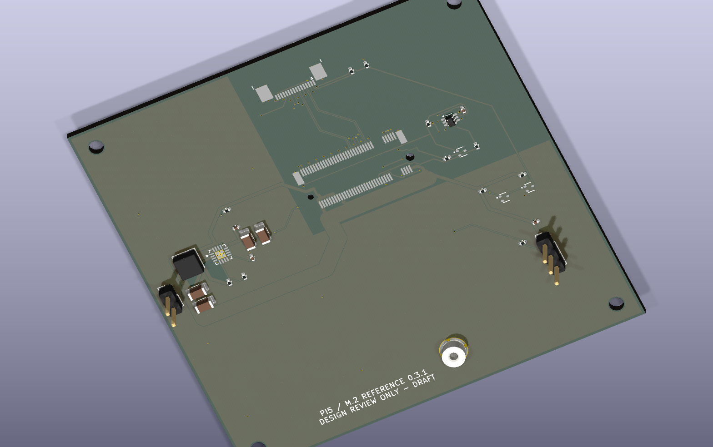

# Engineering portfolio summary

**Qizheng Sui | FPGA / RTL verification and board-design analysis**

## Verified acquisition and DMA simulation

Implemented a SystemVerilog path from synthetic sample generation through saturating processing, ready/valid FIFO buffering, descriptor-controlled ring writes and packetized readback to a Python host scoreboard. A DDR3 **behavioral model** and custom PCIe **transaction-level model** provide bounded storage, stalls, latency and error injection. This is a finite-job, single-clock simulation, with capture followed by readback.

**Results:** 39 pytest + 24 cocotb cases pass; all 33 E2E matrix scenarios match independently computed records. Coverage includes FIFO depths 1/3/8/16, ring sizes 32/257, saturation, stalls, reset/error recovery, 4 KiB boundaries, the last 64-bit address and delayed host delivery. Six selected fault injections challenge checker sensitivity; they do not establish exhaustive coverage.

**Engineering decisions demonstrated:** bounded descriptor ownership, stable handshakes under stalls, explicit integer reference arithmetic, boundary-safe packet segmentation and failure-propagating regression tooling. Real fixes include page crossing, last-address validation, delayed-host ownership and false-success JUnit handling. [Debugging and limitations](../docs/VERIFICATION_REVIEW.md)

**Synthesis:** Yosys generic synthesis and structural checks pass, with 1,447 generic flip-flops and a 42-cell topological path. No FPGA part, placement/routing, device utilization, setup/hold slack or Fmax result exists.

[Architecture](assets/architecture.svg) · [Actual waveform](assets/waveform.svg) · [Simulation benchmark](assets/benchmarks.svg) · [Executed verification](../evidence/core/verification.json)

## Separate board-design study — Rev 0.3.1

A KiCad Pi 5 FFC-to-M.2 reference carrier explores component selection, power distribution, thermal screening, mechanical envelopes and differential impedance. **It does not implement the DAQ RTL.** Native ERC/DRC/connectivity checks report zero violations. Composite voltage, minimum-copper thermal and impedance requirements remain **FAIL**, with all cases retained. No PCB redesign was performed for this portfolio release.

The render is CAD output, not a manufactured board. [Design-study review](../hardware/reference_pcie_adapter/INDEPENDENT_REVIEW.md) · [Schematic](../evidence/pcb/schematic-review.pdf) · [Layout](../evidence/pcb/board-layout.svg)

## Scope and ownership

This is an AI-assisted engineering project, not employment or measured hardware work. Source, tests, actual failure evidence and reproducible commands are available for technical review. No DDR PHY, PCIe endpoint, device timing closure, physical validation or production readiness is claimed.

[Resume bullets](../docs/RESUME_BULLETS.md) · [Four-page engineering review](Independent_Release_Review.pdf) · [System audit](../docs/SYSTEM_AUDIT.md) · [Reproduce](../docs/REPRODUCING.md) · [Release readiness](../release/RELEASE_SUMMARY.md)
